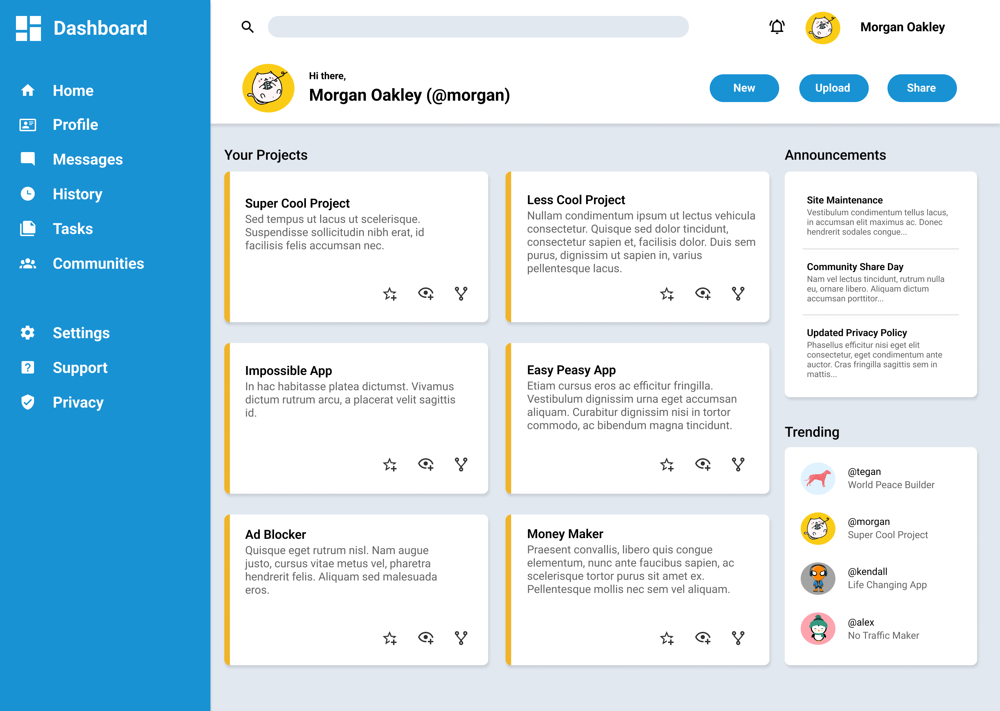

# Admin Dashboard

This was created to complete a project in [The Odin Project](https://www.theodinproject.com/lessons/foundations-landing-page) using just html, css, and js.

These kinds of projects provide an image which we base our webpage on. This project helped me practice CSS Grid Layout. No AI was used in the creation process, [MDN](https://developer.mozilla.org/) was the primary reference.

> Open this on desktop for the intended experience

Link: [Click here](https://loopo79.github.io/theodinproject-admin-dashboard/)

# This was the provided reference image:-

